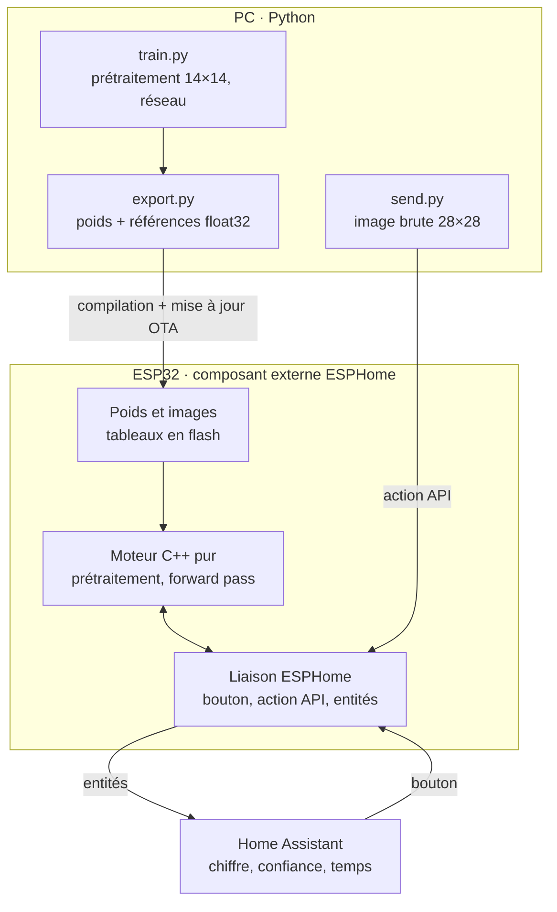

# MNIST sur ESP32 via ESPHome — plan du pipeline

10 octobre 2026 · Antoine

Version de travail : [doc en ligne](https://claude.ai/code/artifact/04314444-caab-432e-8891-45f4bc370ed9)

## Objectif

Faire tourner un petit réseau MNIST sur un ESP32 via ESPHome pour mettre en place, de bout en bout, le pipeline que SpectraSense réutilisera : entraînement sur PC, export, inférence embarquée, publication dans Home Assistant. Pour SpectraSense, seuls la source de données et le modèle changeront.

- **Matériel** : carte de test dédiée, module ESP-WROOM-32 (ESP32 classique, deux cœurs à 240 MHz, unité flottante simple précision). Même processeur que la carte du PZEM, déclaré `board: esp32dev`.
- **Principe** : chaque maillon est validé séparément, avec des références calculées en Python.

## Vue d'ensemble



Le modèle arrive sur l'ESP par compilation et mise à jour OTA ; les images, par le bouton (images en flash) ou par l'action API. Le moteur ne dépend pas d'ESPHome : il est validé sur PC avant d'être flashé.

## train.py — prétraitement et réseau

`train.py` entraîne le réseau et fixe la spécification du prétraitement que le C++ reproduira à l'identique.

**Prétraitement**

1. **Repartir d'entiers.** Reconvertir les images en `uint8` (0–255) dès le chargement. Vérifier le diviseur du chargeur de Nielsen : un maximum de 0,99609375 signifie une division par 256, pas 255.
2. **Réduire 28×28 en 14×14** par moyenne de blocs 2×2, puis division par 255. Aplatissement ligne par ligne en 196 entrées.
3. **Faire la réduction sur l'ESP.** L'ESP stocke et reçoit les images brutes 28×28 (784 octets), comme il recevra les lectures brutes du PZEM.

```python
def preprocess(img_u8):          # (28, 28) uint8
    x = img_u8.reshape(14, 2, 14, 2).mean(axis=(1, 3)) / 255.0
    return x.reshape(196, 1)     # ligne par ligne
```

**Réseau**

- **\[196, 30, 10\]** pour valider le pipeline (environ 6 000 poids, 24 Ko en float32). Ensuite \[196, 100, 10\] (environ 20 000 poids, 80 Ko).
- **Couche cachée sigmoïde, sortie softmax** avec coût log-vraisemblance. L'erreur de sortie reste `a − y` : seule l'activation de la dernière couche change dans `feedforward`. La softmax donne une vraie probabilité pour l'entité « confiance ».
- **Entraînement** : entropie croisée, régularisation L2, planning cosinus, une trentaine d'époques.

**Sortie** : `model.npz` avec poids, biais, tailles de couches, activations, paramètres du prétraitement (facteur 2, diviseur 255) et précision sur le jeu de test.

## export.py — poids et vecteurs de référence

`export.py` lit `model.npz` et génère `model_weights.h` et `test_vectors.h`. C'est la seule source de vérité pour le test sur PC et pour l'ESP.

**Disposition des poids** : `W` de forme `(n_out, n_in)`, écrit ligne par ligne. Le poids de l'entrée `k` vers le neurone `j` est à l'indice `j * n_in + k` (ordre par défaut de numpy, `W.ravel()`). La boucle intérieure du C lit alors les poids de façon contiguë.

**Autocontrôle** : `export.py` refait le forward pass en Python avec des boucles simples, en lisant les tableaux aplatis avec la même formule d'indice que le C. Il s'arrête si le résultat diffère de numpy (bug classique : indices transposés).

**Float32 partout** : l'ESP32 calcule en simple précision (le double y est émulé). Les poids sont arrondis en float32 et écrits avec 9 chiffres significatifs et le suffixe `f`. Les références sont calculées en numpy float32 avec ces poids arrondis.

**`model_weights.h`**

- Tailles et prétraitement : `N_IN = 196`, facteur 2, diviseur 255.
- Une table de couches `{n_in, n_out, W, b, activation}` parcourue par le moteur : changer d'architecture ne demande qu'un nouvel export.
- Un identifiant de modèle (court hachage des poids, précision, date), publié dans HA.

**`test_vectors.h`** (environ 35 Ko)

- Une vingtaine d'images choisies : deux par chiffre, plus quelques images mal classées ou peu sûres.
- Pour chaque image : image brute (784 octets), étiquette, entrée réduite (196), couche cachée (30), sortie (10).

| Ce qui diffère | Où est le bug |
| --- | --- |
| Entrée réduite | Prétraitement |
| Couche cachée | Poids de la couche 1 ou indices |
| Sortie seule | Couche 2 ou softmax |

## Moteur C++ pur et test sur PC

Le moteur ne fait que le forward pass. Il ne dépend que de `<cmath>` et `<cstdint>` : ni ESPHome, ni Arduino, ni allocation dynamique. Environ 80 lignes, validées entièrement sur le PC.

**Fonctions**

- `preprocess(img_u8[784], x[196])` : somme entière des 4 pixels, puis une seule division `(float)somme / 1020.0f`. Identique au bit près à la référence numpy float32 calculée de la même façon.
- `dense(couche, entrée, sortie)` : boucle `z = b[j] + Σ W[j*n_in + k] * a[k]`, puis activation.
  - Sigmoïde : `1 / (1 + expf(-z))`, saine pour `z` très négatif.
  - Softmax : soustraire le maximum avant `expf`, qui déborde vers 88 en float32.
- `forward(modèle, x, résultat)` : parcourt la table de couches avec deux tampons alternés, dimensionnés à la compilation. Résultat : chiffre prédit, confiance (probabilité maximale), marge entre les deux premières probabilités.
- **Crochet de test** : pointeur facultatif où `forward` recopie la sortie de chaque couche (`nullptr` sur l'ESP).

**Test sur PC** (`test_engine.cpp`)

| Étage | Critère |
| --- | --- |
| Entrée réduite | Identique au bit près |
| Couche cachée | Écart < 1e-5 |
| Sortie | Écart < 1e-5 |
| Chiffre prédit | Identique à celui de Python (pas à l'étiquette) |

```
g++ -O2 -Wall test_engine.cpp nn_engine.cpp -o test_engine
```

- Le test compile les fichiers du composant ESPHome eux-mêmes, pas une copie.
- Il affiche un tableau par image et renvoie un code d'erreur au premier échec.
- **On teste le test** : une fois tout vert, introduire volontairement un bug (poids transposés, division par 256). Le test doit échouer, sur le bon étage.
- La tolérance n'est pas nulle : ordre des additions, `expf` et multiplication-addition fusionnée sur Xtensa changent l'arrondi.

## Liaison ESPHome

La liaison reçoit les images, appelle le moteur et publie les résultats. Aucun calcul de réseau n'y figure.

**Arborescence**

```
esphome/
  cnn-test.yaml
  components/nn_mnist/
    __init__.py                 schéma de config + génération de code
    nn_mnist.h / .cpp           la liaison (composant ESPHome)
    nn_engine.h / .cpp          le moteur pur
    model_weights.h             généré par export.py
    test_vectors.h              généré par export.py
```

Le YAML déclare le dossier via `external_components` (source `local`). ESPHome compile tous les `.cpp` du dossier.

**Une seule porte d'entrée** : `NnMnist` hérite de `Component`. Le bouton et l'action API copient 784 octets dans un tampon et lèvent un drapeau. `loop()` fait le reste : réduction 14×14, forward pass chronométré avec `micros()`, comparaison aux références pour les images de test, publication.

```yaml
nn_mnist:
  id: mnist

button:
  - platform: template
    name: "Image de test suivante"
    on_press:
      - lambda: id(mnist).next_test_image();

api:
  actions:
    - action: classify
      variables:
        image: int[]
      then:
        - lambda: id(mnist).submit_image(image);
```

`int[]` arrive en `std::vector<int32_t>`. `submit_image` vérifie 784 valeurs entre 0 et 255, sinon rejet signalé dans les logs.

**Entités publiées dans HA**

| Entité | Type | Rôle |
| --- | --- | --- |
| Chiffre prédit | sensor | Résultat |
| Confiance | sensor (%) | Probabilité maximale |
| Marge | sensor | Écart entre les deux meilleures probabilités |
| Temps d'inférence | sensor (µs) | Performance |
| Étiquette attendue | sensor | Images de test seulement |
| Écart max vs Python | sensor | Images de test seulement |
| Modèle | text\_sensor | Identifiant publié au démarrage |

- **Bouton « Autotest »** : passe les 20 images de test et publie un bilan (« 20/20 conformes », écart maximal, temps moyen). À lancer après chaque mise à jour OTA.
- **Détail par étage** dans les logs ESPHome (`ESP_LOGD`), pas dans HA.
- **Ne pas bloquer la boucle** : ESPHome signale un composant qui garde la main plus de 30 ms environ. Sans risque ici ; à surveiller avec un CNN plus gros.
- **Option `test_vectors: true`** pour inclure les vecteurs de test à la compilation, réutilisable pour embarquer des cycles SpectraSense de référence.

## send.py — envoi d'images depuis Python

`send.py` pousse une image 28×28 vers l'ESP par l'API native ESPHome, sans passer par Home Assistant, avec la bibliothèque `aioesphomeapi`.

1. Se connecter à l'ESP (port 6053, clé de chiffrement de la section `api:` du YAML).
2. Lister les actions exposées et retrouver `classify`.
3. Envoyer l'image en `uint8` brut : liste de 784 entiers, ligne par ligne, sans prétraitement.
4. S'abonner aux états et lire le chiffre prédit, la confiance et le temps d'inférence publiés après l'envoi.

Usages : envoyer une image quelconque du jeu de test complet, puis plus tard un chiffre dessiné à la main. Les noms exacts des appels `aioesphomeapi` sont à vérifier sur la version installée.

## Ordre de mise en route

Chaque étape valide un seul maillon ; on ne passe à la suivante que si son critère est rempli.

1. **Composant externe vide** qui affiche « hello » dans les logs. Critère : compilation et mise à jour OTA de la carte de test réussies.
2. **`train.py` et `export.py`**. Critère : l'autocontrôle d'`export.py` passe ; précision 14×14 notée.
3. **Moteur C++ sur PC**. Critère : tous les étages conformes sur les 20 images, et le bug volontaire détecté au bon étage.
4. **Sur l'ESP avec les images embarquées**. Critère : Autotest à 20/20, temps d'inférence mesuré.
5. **Envoi depuis `send.py`**. Critère : sur des images hors du jeu embarqué, même chiffre prédit qu'en Python.
6. **Bonus** : quantification int8, puis un CNN 2D qui prépare le CNN 1D de SpectraSense.

## Prédictions et lien avec SpectraSense

**Prédictions à vérifier**

| Mesure | Prédiction | Résultat |
| --- | --- | --- |
| Perte de précision 28×28 → 14×14 | Moins d'un point |  |
| Perte de précision en 7×7 | Quelques points |  |
| Écart sur l'entrée réduite | Nul |  |
| Écart couche cachée et sortie (PC) | De l'ordre de 1e-7 |  |
| Chiffre prédit, C vs Python | Identique sur 20/20 |  |
| Temps d'inférence \[196, 30, 10\] sur ESP | Quelques centaines de µs, première inférence plus lente (cache flash froid) |  |

**Correspondance avec SpectraSense**

| MNIST | SpectraSense |
| --- | --- |
| Images en flash | Cycles rejoués depuis l'historique |
| Action API depuis Python | Lectures du PZEM en direct |
| Moyenne 2×2 | Rééchantillonnage et normalisation |
| Chiffre et confiance | Appareil, phase et confiance |
